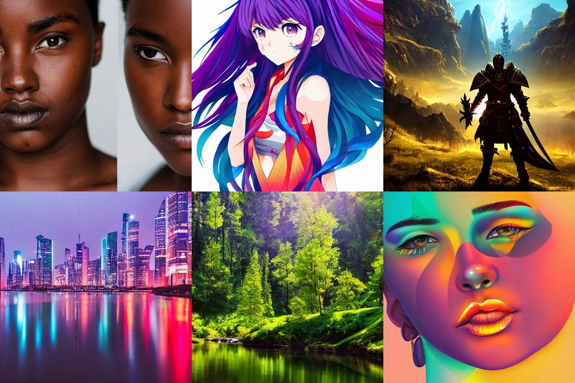

# Image Enhancement, Generation and Style Transfer

[](https://www.kaggle.com/code/bodyastar/image-enhancement-generation-style-transfer)

ESRGAN super-resolution, Stable Diffusion v1.5 and VGG19 neural style transfer, compared in one reproducible notebook.

## Overview

The notebook `image_enhancement_generation_style_transfer.ipynb` explores three families of models for images:

| Part | Task | Model | Library |
|---|---|---|---|
| 1 | 4x super-resolution | ESRGAN (`esrgan-tf2`) | TensorFlow Hub |
| 2 | Text-to-image and image-to-image generation | Stable Diffusion v1.5 | Hugging Face `diffusers`, PyTorch |
| 3 | Neural style transfer | VGG19 (ImageNet weights) | TensorFlow / Keras |

## What is inside

- **ESRGAN:** side-by-side comparison with the originals, and a quantitative benchmark (PSNR and SSIM against bicubic interpolation) on simulated 4x downscaled images.
- **Stable Diffusion:** six styled prompts, and controlled experiments that change one parameter at a time with a fixed seed: guidance scale, negative prompt and the img2img `strength`.
- **Style transfer:** Gram-matrix style loss, content loss and total variation regularization, with a recorded loss curve.

## Results

### ESRGAN vs. bicubic interpolation

Each test image was downscaled 4x with bicubic interpolation, then upscaled back with bicubic interpolation and with ESRGAN, and compared with the original (15 images).

| Metric | Bicubic | ESRGAN |
|---|---|---|
| Mean PSNR (dB) | 24.4868 | **25.3250** |
| Mean SSIM | 0.6956 | **0.7359** |

ESRGAN achieved a higher SSIM on all 15 images and a higher PSNR on 14 of 15 (the exception is image 0807, where bicubic was marginally better). The mean gain is +0.84 dB PSNR and +0.040 SSIM, but it varied by image: from almost zero (images 0807, 0809 and 0811) to about +2.8 dB (image 0803).

<details>
<summary>Per-image results</summary>

| Image | PSNR bicubic | PSNR ESRGAN | SSIM bicubic | SSIM ESRGAN |
|---|---|---|---|---|
| 0801x4.png | 22.6197 | 23.1400 | 0.5514 | 0.6194 |
| 0802x4.png | 27.1498 | 29.7806 | 0.8462 | 0.8557 |
| 0803x4.png | 26.5398 | 29.3292 | 0.8523 | 0.8868 |
| 0804x4.png | 21.4771 | 22.3625 | 0.5830 | 0.6583 |
| 0805x4.png | 24.9408 | 25.3389 | 0.6507 | 0.6990 |
| 0806x4.png | 25.3269 | 26.0033 | 0.7762 | 0.8028 |
| 0807x4.png | 22.1161 | 22.0632 | 0.5369 | 0.5614 |
| 0808x4.png | 24.3525 | 25.4123 | 0.7769 | 0.8018 |
| 0809x4.png | 25.5021 | 25.5330 | 0.5952 | 0.6352 |
| 0810x4.png | 25.9795 | 26.1294 | 0.6887 | 0.7198 |
| 0811x4.png | 25.0036 | 25.0220 | 0.6030 | 0.6335 |
| 0812x4.png | 22.7846 | 23.6956 | 0.6778 | 0.7327 |
| 0813x4.png | 23.6749 | 25.0195 | 0.7319 | 0.7854 |
| 0814x4.png | 24.8322 | 25.1338 | 0.8121 | 0.8416 |
| 0815x4.png | 25.0023 | 25.9114 | 0.7518 | 0.8048 |
| **Mean** | **24.4868** | **25.3250** | **0.6956** | **0.7359** |

</details>

Caveats: the test degradation (bicubic downscaling) is the one the model was trained for, so the numbers say little about real-world artifacts such as JPEG compression or noise. The input files are themselves low-resolution (x4) versions, so the references are not true high-resolution images, and the absolute values cannot be compared with published benchmarks.

### Stable Diffusion

Text-to-image samples (512x512): realistic portrait, anime, fantasy, cyberpunk, nature and digital art. The model still makes visible mistakes, for example the duplicated face in the portrait.



The notebook also compares guidance scales (3, 7, 12, 20), generation with and without a negative prompt, and img2img strengths (0.3, 0.5, 0.75, 0.95), all with a fixed seed. These results are evaluated qualitatively.

### Neural style transfer

500 optimization steps (10 epochs of 50 steps) took 37.6 s on a Kaggle GPU; the final total loss was about 3.73 x 10^6. The loss combines three weighted terms, so its absolute value is not meaningful on its own and serves mainly as a convergence check.

## Setup

**Option 1: Run on Kaggle (recommended).** Open the [Kaggle notebook](https://www.kaggle.com/code/bodyastar/image-enhancement-generation-style-transfer), enable a **GPU** accelerator and turn **Internet** on (models are downloaded from TensorFlow Hub and the Hugging Face Hub). Attach the input data described in the next section.

**Option 2: Run locally.**

1. Install the dependencies:

   ```bash
   pip install tensorflow tensorflow-hub keras torch diffusers transformers accelerate matplotlib pandas pillow
   ```

2. Download the input images and edit the paths at the top of the notebook (`ESRGAN_INPUT_DIR`, `IMG2IMG_INPUT`, `STYLE_DATA_DIR`, `OUTPUT_DIR`).
3. A CUDA GPU is required for Stable Diffusion.

Outputs (comparison figures, generated images, the stylized image) are saved to the directory set in `OUTPUT_DIR`.

## Data

The repository does not include any input images.

- **ESRGAN test images:** the first 15 images (`0801x4.png` to `0815x4.png`) of the DIV2K validation set, bicubic x4 low-resolution version. DIV2K is made available for academic research purposes only, so the images are **not** redistributed here. Download the dataset from the [official DIV2K page](https://data.vision.ee.ethz.ch/cvl/DIV2K/) and place the images in the folder set in `ESRGAN_INPUT_DIR`.
- **Image-to-image input:** a single demonstration image (`girl.png`) from the Kaggle dataset [img2imgprediffusedimages](https://www.kaggle.com/datasets/bodyastar/img2imgprediffusedimages). The image is not redistributed in this repository; use any image you have the right to process.
- **Style transfer images:** [images-for-style-transfer](https://www.kaggle.com/datasets/soumikrakshit/images-for-style-transfer) by Soumik Rakshit (the content image `TestCases/22714.jpg` and the artwork `Artworks/108700.jpg`). The images are not redistributed here. Check the dataset page for its license and the copyright status of the individual artworks before reusing them.

If you cite the ESRGAN benchmark data, please also cite:

> Agustsson, E., Timofte, R. *NTIRE 2017 Challenge on Single Image Super-Resolution: Dataset and Study.* CVPR Workshops, 2017.
>
> Timofte, R. et al. *NTIRE 2017 Challenge on Single Image Super-Resolution: Methods and Results.* CVPR Workshops, 2017.

## Models and licenses

| Model | Source | License |
|---|---|---|
| ESRGAN | [Kaggle Models](https://www.kaggle.com/models/kaggle/esrgan-tf2) (formerly TensorFlow Hub, `captain-pool/esrgan-tf2`) | See the license on the model page |
| Stable Diffusion v1.5 | Hugging Face (community mirror of the original weights) | CreativeML OpenRAIL-M, which includes use-based restrictions |
| VGG19 | Keras Applications, ImageNet weights ported from the Oxford Visual Geometry Group | Creative Commons Attribution (CC BY) |

The original `runwayml/stable-diffusion-v1-5` repository was removed from the Hugging Face Hub, so the notebook loads a mirror (`stable-diffusion-v1-5/stable-diffusion-v1-5`). If it becomes unavailable, change `SD_MODEL_ID` in the notebook.

## Limitations

- ESRGAN expects inputs of at least 64x64 px and was trained on bicubic-downscaled images, so it does not necessarily repair real-world degradation such as strong compression artifacts or noise.
- PSNR and SSIM measure pixel fidelity, not perceptual quality, and may disagree with how sharp the result looks. The benchmark uses only 15 images.
- Stable Diffusion results are evaluated qualitatively. The model can produce distorted anatomy, duplicated features and unreadable text.
- Style transfer is an optimization per image: it is slow compared with feed-forward style transfer models and sensitive to the loss weights.
- Generated images can reflect biases of the training data. Do not use photos of real people in image-to-image generation without their consent.

## Reproducibility

Seeds are fixed for Python, NumPy, TensorFlow and PyTorch, and every Stable Diffusion generation uses a seeded generator. Results can still vary with library versions and GPU hardware.

## Future improvements

- Evaluate on a larger set with true high-resolution references and perceptual metrics such as LPIPS.
- Compare ESRGAN with Real-ESRGAN on images with real-world degradation.
- Replace per-image optimization with a fast feed-forward style transfer model.
- Study systematically how the style, content and total variation weights affect the result.

## References

- Goodfellow, I. et al. *Generative Adversarial Networks.* arXiv:1406.2661, 2014.
- Wang, X. et al. *ESRGAN: Enhanced Super-Resolution Generative Adversarial Networks.* arXiv:1809.00219, 2018.
- Rombach, R. et al. *High-Resolution Image Synthesis with Latent Diffusion Models.* arXiv:2112.10752, 2021.
- Gatys, L. A., Ecker, A. S., Bethge, M. *A Neural Algorithm of Artistic Style.* arXiv:1508.06576, 2015.
- Simonyan, K., Zisserman, A. *Very Deep Convolutional Networks for Large-Scale Image Recognition.* arXiv:1409.1556, 2014.
- Agustsson, E., Timofte, R. *NTIRE 2017 Challenge on Single Image Super-Resolution: Dataset and Study.* CVPR Workshops, 2017.
- Timofte, R. et al. *NTIRE 2017 Challenge on Single Image Super-Resolution: Methods and Results.* CVPR Workshops, 2017.

## License

The code in this repository is released under the MIT License (see `LICENSE`). Input data and pretrained models keep their original licenses (see above).
